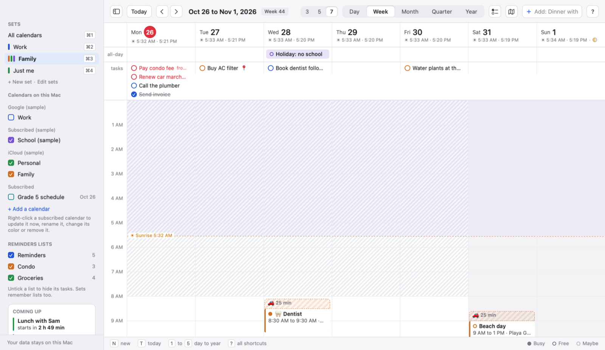
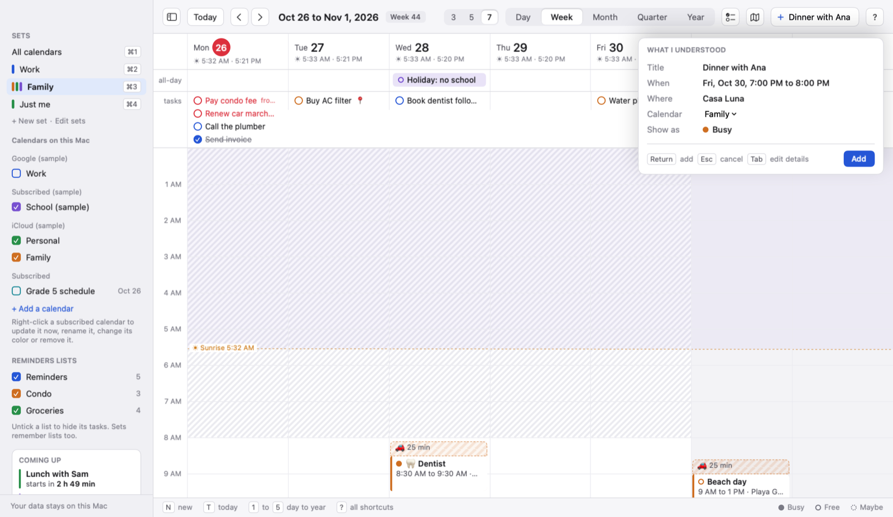
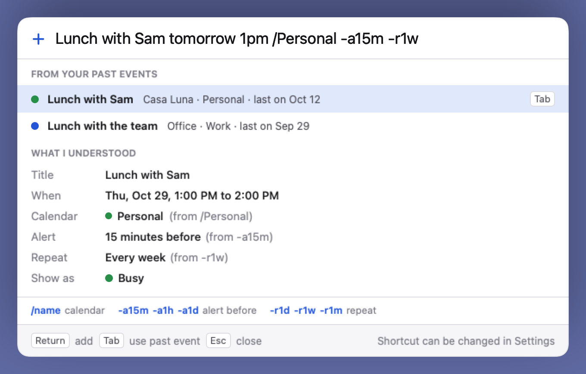
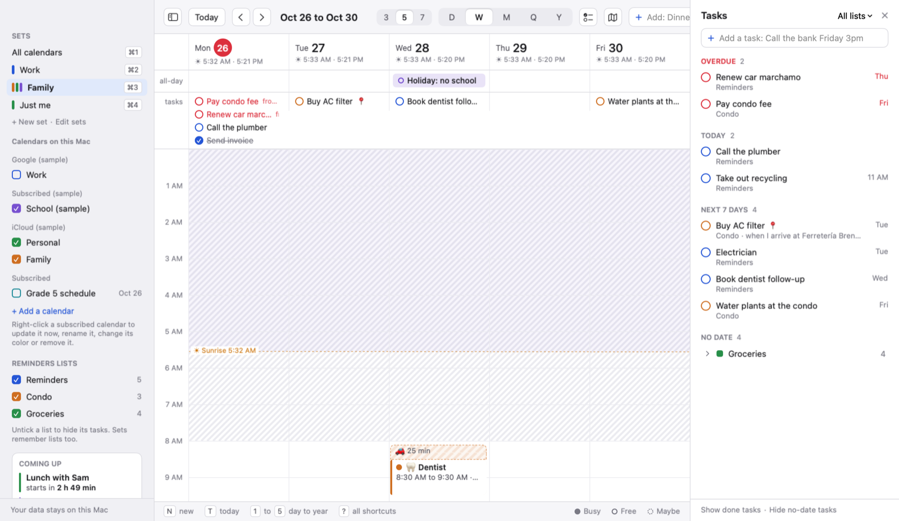
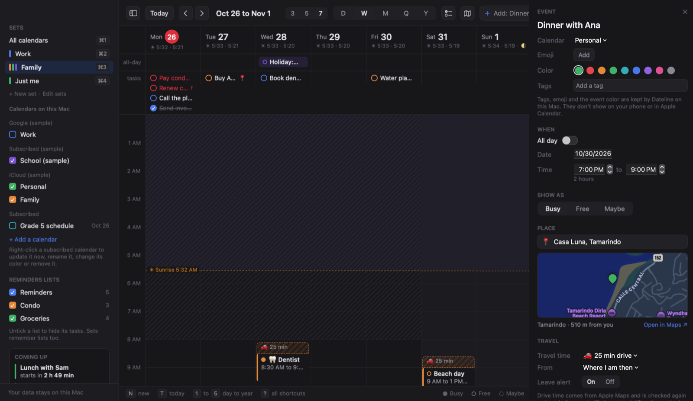
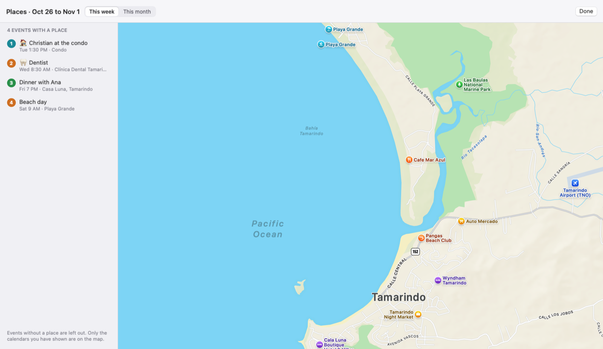
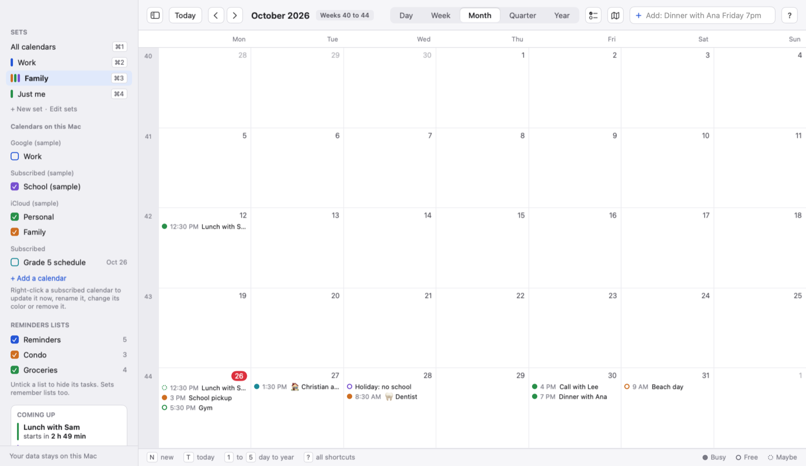
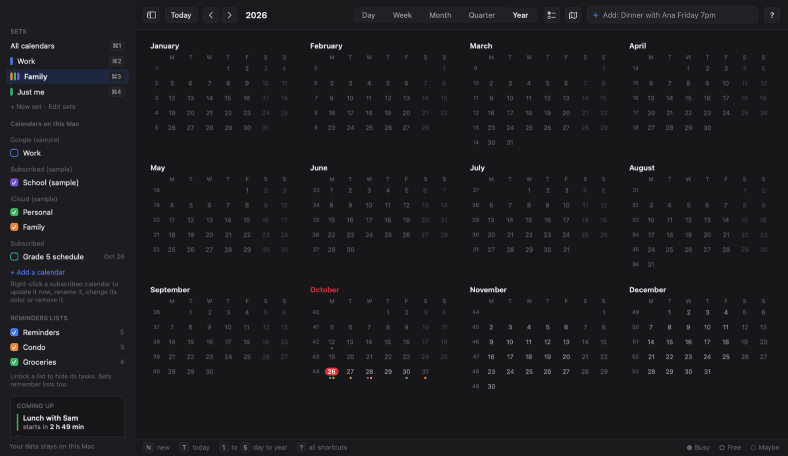

# Dateline

A calendar app for the Mac. It works with the calendars and Apple Reminders already set up on your Mac (iCloud, Google, Exchange and anything else in Apple Calendar), so there are no new accounts to set up. Your data stays on your Mac.



## Features

**Views**
- Day, week (3, 5 or 7 days), month, quarter and year views. Keys 1 to 5 switch between them.
- Week numbers, sunrise and sunset under each day, and moon phases.
- A side panel with your calendars that you can hide with the toolbar's first button or the S key.
- A "Coming up" card with a countdown to your next events.
- Light and dark mode, plus Look settings for the font, text size, spacing and hour height.

**Adding events by typing**
- Type a sentence such as "Dinner with Ana Friday 7pm at Casa Luna" and Dateline fills in the title, time and place, and shows you what it understood before adding.
- Short codes: `/name` picks a calendar, `-a15m`, `-a1h` or `-a1d` sets an alert, and `-r1d`, `-r1w` or `-r1m` makes it repeat.
- Suggestions from your past events: press Tab to reuse one.
- Quick add from any app with Control Option Space (you can change it in Settings), or from the menu bar icon.





**Editing**
- Drag events to move them, drag the bottom edge to make them longer, and hold Option while dragging to copy.
- Option Up and Option Down nudge an event by 15 minutes. Command Z undoes.
- Busy, Free and Maybe for each event.
- Emoji, colors, tags and formatted notes on any event.

**Organizing**
- Calendar sets: groups of calendars you switch between with Command 1 to 9, such as Work, Family or Just me.
- Calendars from a web address (school schedules, sports fixtures, holidays), plus a short list of ready-made ones.
- Settings for the first day of the week and your working hours.

**Tasks**
- Apple Reminders appear on the calendar, and your changes are saved back to Reminders.
- A task panel (key R) with overdue, today, next 7 days and no-date tasks, grouped by list.
- Reminders that go off when you arrive somewhere, including Home and Work from your contact card.



**Places and travel**
- A map in each event that has a place, and a map of all the week's or month's places (key P).
- Drive time blocks before events, with an alert telling you when to leave. Drive times come from Apple Maps.





**Alerts and time zones**
- A full screen alert for the calendars you choose, with sounds.
- Extra time zones shown next to your own.
- A menu bar icon that can show your next event, with today's events and tasks and quick add in its menu.





Press ? in the app for every keyboard shortcut.

## Install

You need a Mac with macOS 14 (Sonoma) or newer. Dateline is built from this code on your own Mac, using Apple's free developer tools.

1. **Install Apple's developer tools.** Open Terminal and run:

   ```
   xcode-select --install
   ```

   Click Install in the window that appears. If you already have Xcode or the tools, Terminal says so and you can skip this step.

2. **Download the code.** This repository is private, so sign in to GitHub first. The easiest way is the [GitHub CLI](https://cli.github.com) (`brew install gh`, then `gh auth login`):

   ```
   gh repo clone B0xfan/dateline
   cd dateline
   ```

   GitHub Desktop works too: File > Clone Repository, then pick `B0xfan/dateline`.

3. **Build and install.**

   ```
   scripts/local-build.sh
   scripts/install.sh
   ```

   The first command builds the app and runs its self-checks. The second puts Dateline in your Applications folder and opens it. The first build is the slow one.

4. **Allow access.** On first open, macOS asks for permission to use Calendar and Reminders. Click Allow for both. Dateline asks for your location only when you first use drive times or sunrise and sunset.

### Updating

From the `dateline` folder:

```
git pull
scripts/local-build.sh
scripts/install.sh
```

Your settings and calendars are kept. On your Mac, macOS may ask for Calendar and Reminders permission again after each update, because the app is signed on your Mac rather than with a paid Apple developer certificate. Click Allow again and you're set.

### Try it without your calendars

```
.build/release/Dateline --sample
```

This opens Dateline on made-up calendars, without asking for any access.
