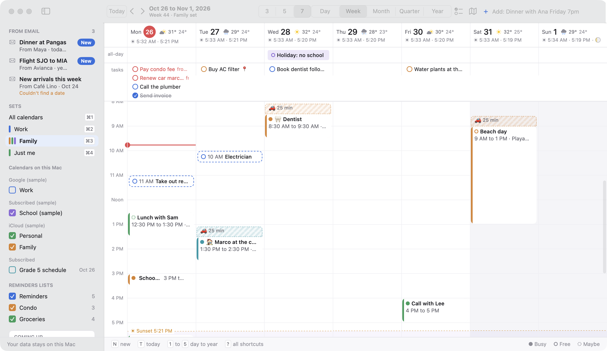
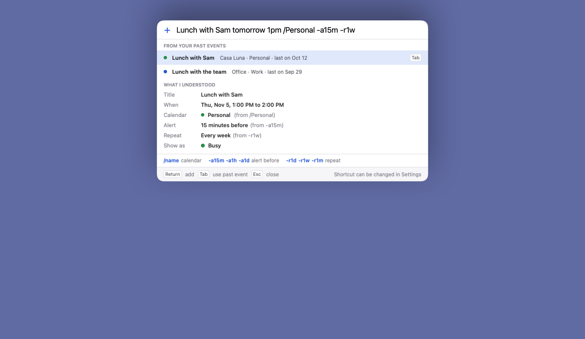
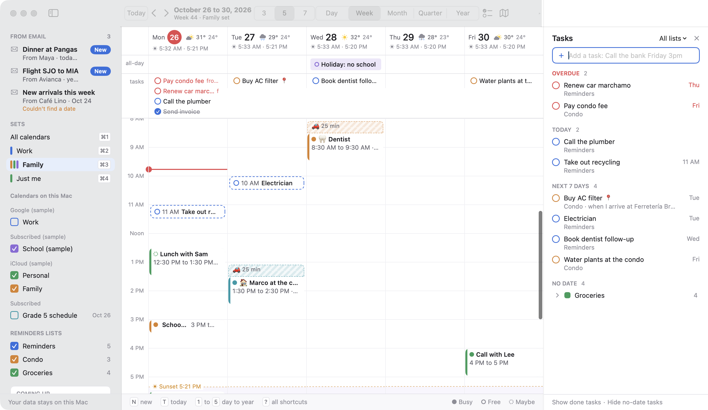
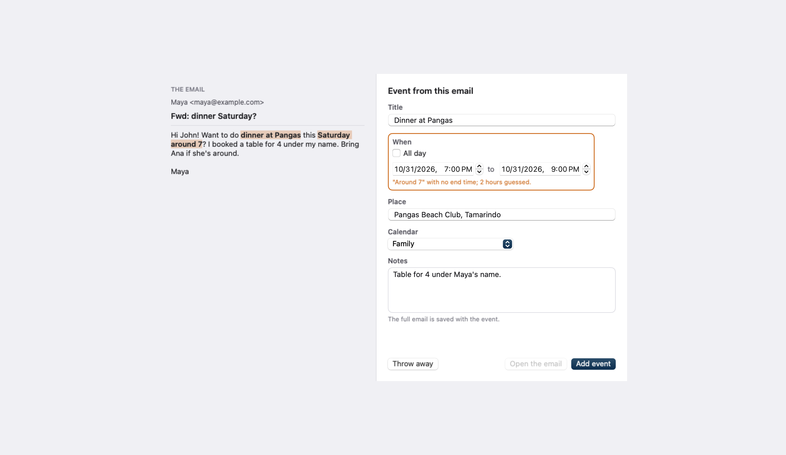
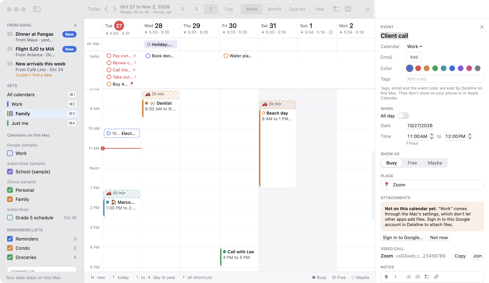
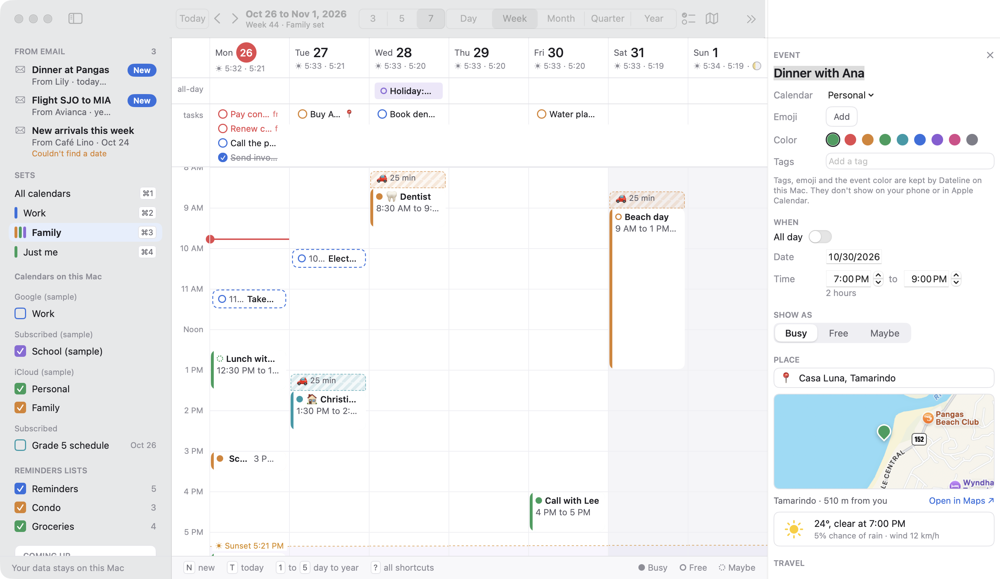
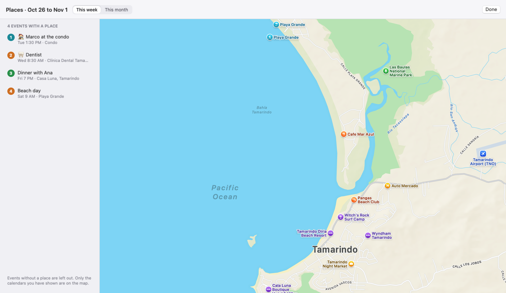
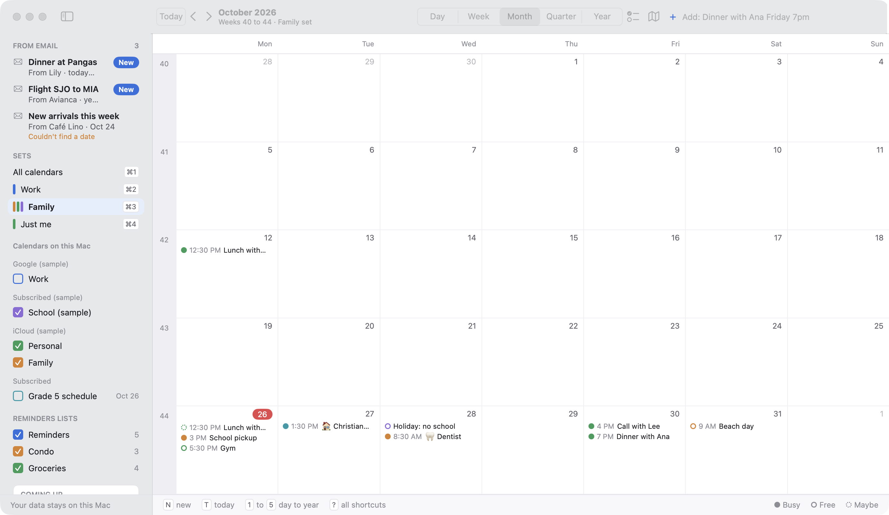
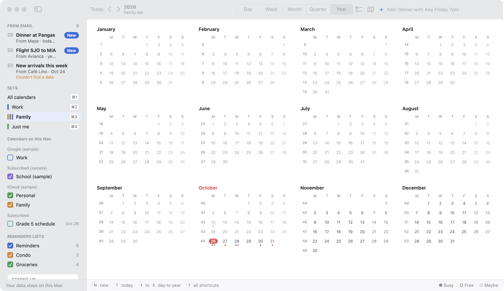

# Dateline

A calendar app for the Mac. It works with the calendars and Apple Reminders already set up on your Mac (iCloud, Google, Exchange and anything else in Apple Calendar), so there are no new accounts to set up. Your data stays on your Mac.

**[Download the free 7 day trial](https://github.com/B0xfan/dateline/releases/latest/download/Dateline.dmg)** · **[Buy Dateline for $29.99](https://payhip.com/b/P4iIX)** · [dateline.app](https://dateline.app)

One payment, no subscription. All updates are free.

## Features

**Views**
- Day, week (3, 5 or 7 days), month, quarter and year views. Keys 1 to 5 switch between them.
- Week numbers, sunrise and sunset under each day, and moon phases.
- A side panel with your calendars that you can hide with the toolbar's first button or the S key.
- A "Coming up" card with a countdown to your next events.
- Light and dark mode, plus Look settings for the font, text size, spacing and hour height.

**Adding events by typing**
- Type a sentence such as "Dinner with Ana Friday 7pm at Casa Luna" and Dateline fills in the title, time and place, and shows you what it understood before adding.
- Short codes: `/name` picks a calendar, `-a15m`, `-a1h` or `-a1d` sets an alert, and `-r1d`, `-r1w` or `-r1m` makes it repeat.
- Suggestions from your past events: press Tab to reuse one.
- Quick add from any app with Control Option Space (you can change it in Settings), or from the menu bar icon.

**Editing**
- Drag events to move them, drag the bottom edge to make them longer, and hold Option while dragging to copy.
- Option Up and Option Down nudge an event by 15 minutes. Command Z undoes.
- Busy, Free and Maybe for each event.
- Emoji, colors, tags and formatted notes on any event.

**Organizing**
- Calendar sets: groups of calendars you switch between with Command 1 to 9, such as Work, Family or Just me.
- Calendars from a web address (school schedules, sports fixtures, holidays), plus a short list of ready-made ones.
- Settings for the first day of the week and your working hours.

**Tasks**
- Apple Reminders appear on the calendar, and your changes are saved back to Reminders.
- A task panel (key R) with overdue, today, next 7 days and no-date tasks, grouped by list.
- Reminders that go off when you arrive somewhere, including Home and Work from your contact card.

**Events from email and video calls**
- Turn a saved email into an event with File > Make Event from Email File. Apple's on-device AI reads it, and Dateline shows you what it found before anything is added. This needs Apple Intelligence on macOS 26 or newer.
- A Join button for Zoom, Google Meet and Teams calls, in the event and on the full screen alert.

**Places and travel**
- A map in each event that has a place, and a map of all the week's or month's places (key P).
- Drive time blocks before events, with an alert telling you when to leave. Drive times come from Apple Maps.

**Alerts and time zones**
- A full screen alert for the calendars you choose, with sounds.
- Extra time zones shown next to your own.
- A menu bar icon that can show your next event, with today's events and tasks and quick add in its menu.

Press ? in the app for every keyboard shortcut.

## Install

You need a Mac with macOS 14 (Sonoma) or newer.

1. Download [Dateline.dmg](https://github.com/B0xfan/dateline/releases/latest/download/Dateline.dmg), the newest version. It is signed and checked by Apple.
2. Open Dateline.dmg and drag Dateline onto the Applications folder in the window that appears, then open Dateline from Applications.
3. When macOS asks for permission to use Calendar and Reminders, click Allow for both. Dateline asks for your location only when you first use drive times or sunrise and sunset.

### Free trial and buying

Every copy starts with a 7 day free trial. After that your calendar is still there to look at, and adding or changing events needs a key. [Buy Dateline on Payhip](https://payhip.com/b/P4iIX) for $29.99 once; your key comes in the email from Payhip. Paste it into Settings > License. The same key works on a new Mac.

### Updates

All updates are free. Use Dateline > Check for Updates, or let it check every day by itself. Your settings and calendars are kept.

## License

Copyright 2026 John Hesch. All rights reserved. The code is here to read; copying, building or changing it needs written permission. See [LICENSE](LICENSE).
